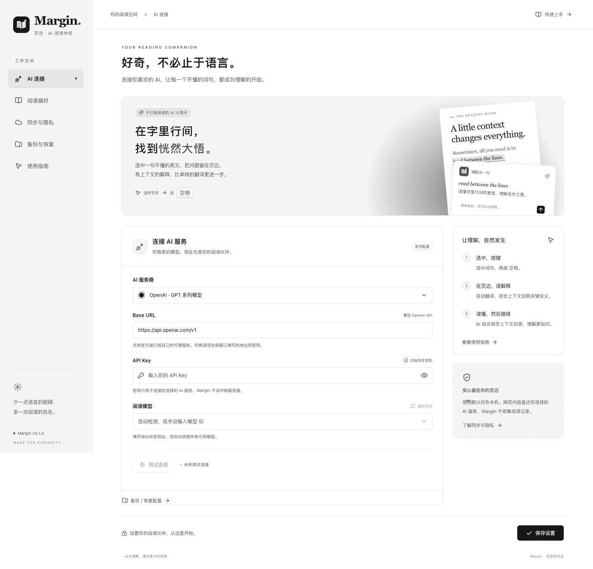
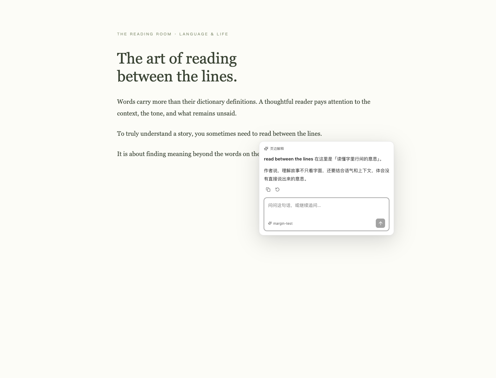

# Margin · 页边

**看懂这一句，继续你的好奇。**

一个结合网页上下文的 AI 英文阅读助手。选中单词、短语或句子，再按 **空格键**，即可在旁边自动翻译并结合上下文解释，还能继续追问。



## 立即安装

项目构建产物位于 `.output/chrome-mv3/`。

1. 在 Chrome 打开 `chrome://extensions`，开启右上角「开发者模式」。
2. 点击「加载已解压的扩展程序」，选择本项目的 **`.output/chrome-mv3` 文件夹**。macOS 文件选择器可按 `Command + Shift + G` 粘贴完整路径；隐藏文件可用 `Command + Shift + .` 显示。
3. 将 Margin 固定到工具栏，点击图标填写服务商、Base URL、API Key。
4. 等待自动获取模型列表，选择模型，点击「测试连接」和「保存设置」。测试会发送一条很短的真实请求，可能产生少量服务商费用。
5. **刷新已打开的普通网页**，选中文字后按 `空格`，卡片会自动翻译并结合上下文解释，输入框支持继续追问。

Chrome 内置页面、扩展商店、浏览器 PDF 阅读器和其他扩展页面不支持注入；当前不进入 iframe。默认不会在输入框和编辑区触发。

## 技术选择

| 部分     | 实现                        | 原因                                                                                                                            |
| -------- | --------------------------- | ------------------------------------------------------------------------------------------------------------------------------- |
| 扩展框架 | WXT + Chrome Manifest V3    | 统一管理后台、内容脚本、工具栏弹窗和设置页面，支持开发热更新与打包                                                              |
| UI       | React + TypeScript          | 浮窗和设置复用组件，通信与状态有类型约束                                                                                        |
| AI 对话  | assistant-ui                | 直接使用 LocalRuntime、Thread、Message、Composer、Suggestion、ActionBar、Error 与 Markdown 组件，提供流式回答、取消、复制和重试 |
| 样式     | 独立 CSS + Shadow DOM       | 延续 assistant-ui 的简洁交互，使用黑白灰高对比配色；网页样式不影响阅读浮窗                                                      |
| AI 接口  | OpenAI 兼容 REST / SSE      | 支持多服务商与本地模型，无需部署服务器；请求只从扩展后台发出                                                                    |
| 设置     | chrome.storage.local / sync | 默认同步非敏感配置；密钥默认仅存本机，可主动选择同步                                                                            |
| 验证     | Vitest + Playwright         | 单元测试和真正加载扩展的 Chromium 测试                                                                                          |

assistant-ui 官方参考：[LocalRuntime](https://www.assistant-ui.com/docs/runtimes/custom/local-runtime)、[Thread](https://www.assistant-ui.com/docs/api-reference/primitives/thread)、[Composer](https://www.assistant-ui.com/docs/api-reference/primitives/composer)。设置表单和品牌插画为自定义组件，聊天使用官方 primitives；文字输入使用连接同一 Composer Runtime 的原生 textarea，避免受控输入在中文输入法组词期间清空文字。

## 功能

- 点击工具栏图标即可配置；完整设置页包含 AI 连接、阅读偏好、同步与隐私、使用指南。
- 输入即时保留为本机草稿，关闭弹窗或设置页后可继续填写；未填完的地址也会保留。点击「保存设置」后正式应用并按偏好同步，草稿本身不会同步。切换服务商或修改其他选项不会清空地址和密钥，可点击「使用默认地址」主动填入所选服务商的地址。
- OpenAI、DeepSeek、OpenRouter、Ollama 和自定义兼容接口；模型列表来自 `GET /models`，支持搜索、刷新和手动输入。列表代表服务商返回的模型，是否支持聊天及当前密钥能否调用，以测试连接为准。
- 在「阅读模型」下设置「思考强度」：跟随模型默认、关闭思考、低、中、高。弹窗与完整设置页均可修改，随配置保存、同步和备份；旧配置与旧备份默认跟随模型。测试连接、首次解释和追问使用同一设置。
- 先选中文字，再按快捷键（默认空格），直接在选区旁显示翻译与上下文解释；卡片支持继续追问，随滚动调整位置。没有正文选区、正在输入或使用输入法时不拦截空格。
- 默认按「翻译 → 词汇 → 上下文解释」的顺序回答，在翻译下方另加一行「词汇」，列出选区中约四级及以上难度的单词和较难词组：单词附 IPA 音标，词义按当前语境翻译。没有符合条件的词汇时省略，追问时不重复列出；难度与音标由所选 AI 模型判断。
- 快捷键支持单键、修饰键及组合键，完整按下并松开后确认，Esc 取消录入。旧版默认 Option / Alt 自动升级为空格，已有自定义组合保留；可随时恢复为空格。含修饰键的快捷键仍支持按住后拖选文字，其自动解释可单独开关。
- 默认提供页面标题、去掉查询参数的 URL、选中文字、所在段落和当前可见正文。可缩小为仅段落或仅选区。
- 流式 Markdown 回答、继续追问、停止生成、复制回答、重新生成；关闭浮窗取消请求并释放本次对话。
- 首次解释保持在顶部，发送追问时滚到最新消息并跟随回答；手动向上翻看时暂停跟随，回到底部或点击「滚动到最新回答」后恢复。
- SVG Logo 位于 [`public/logo.svg`](public/logo.svg)，PNG 图标由该 SVG 自动生成。



## 同一 Google 账号的同步

**配置同步**：默认将服务地址、模型、快捷键和阅读偏好写入 `chrome.storage.sync`。登录同一 Chrome 账号并启用同步后，由 Chrome 负责传递。是否已登录、何时同步成功不由扩展直接控制，因此 UI 不会虚报「已同步到另一台设备」。同步开关本身是设备级选项。

**API Key**：默认只存当前设备。可在「同步与隐私」主动开启「同时同步 API Key」；关闭此选项会移除远端保存的密钥。Chrome 同步存储不是专业密码保险库，可使用独立且限额的密钥。密钥绑定服务地址，避免其他设备切换地址后误发原服务商密钥。

**自动安装**：需要通过 Chrome Web Store 正式发布，且用户开启扩展程序同步。本地开发版仍需在各设备分别加载。本项目包含固定的开发公钥 `extension-identity.json`，让同一构建在不同路径和设备上保持相同扩展 ID。公钥不是秘密，不包含签名私钥；发布商店时应替换为商店分配的公钥。项目尚未上架，也未使用真实账号验证跨设备同步。

## 卸载后恢复配置

1. 在插件弹窗点击「备份 / 恢复配置」，或进入完整设置的「备份与恢复」。有未保存的修改时，先点击「保存设置」。
2. 点击「备份已保存配置」，保留下载的 `margin-settings-*.json` 文件。可以存放在本地文件夹或自己的网盘中；更新模型或密钥后请重新备份。
3. 重装插件或换设备后，打开同一入口，点击「从备份恢复」并选择该文件。服务商、Base URL、API Key、模型和阅读偏好会立即恢复并保存，无需再次逐项填写。

备份包含**明文 API Key**，请妥善保存。导入保留当前设备的同步开关，备份文件不会替你开启密钥同步。格式不正确或版本不支持的文件会被拒绝，不会修改现有配置。

Chrome 在卸载扩展时会清除扩展存储，Chrome 同步不能作为卸载后的备份保证。外部备份文件不随卸载删除，但重装后需要由你选取文件；插件没有自动访问电脑文件或网盘的权限。

## 隐私与权限

- `storage`：存储与同步设置。local 和 sync 都设置为 `TRUSTED_CONTEXTS`；内容脚本不能读取密钥，只能取得去除敏感字段的配置。
- HTTP/HTTPS 网页匹配与主机权限：用于在普通网页划词，并从后台连接用户自定义的 AI 地址。AI 服务地址支持 HTTP 和 HTTPS，可使用远程、局域网或本机接口。
- 不请求 Cookie、浏览历史、身份信息或剪贴板读取权限。API 请求使用 `credentials: omit`，拒绝重定向，避免密钥被带到其他地址。
- 默认上下文排除表单、编辑区、隐藏元素和导航区域，最多发送 6,000 字符选区、6,000 字符段落、12,000 字符可见正文。长对话仅携带最近 16 条消息，每条上限 10,000 字符。
- 网页内容作为不可信引用资料放在独立消息中；系统提示词明确禁止将网页中的指令当作系统命令。这是纵深防护，不代表能保证任何模型绝对不受提示注入影响。
- 不保存或同步网页阅读记录和对话，不使用统计分析。AI 回答里的图片不加载；链接仅允许 HTTP/HTTPS，点击时不发送 Referer。
- AI 服务商会接收你主动发送的文字及选定上下文，其存储与保留政策由服务商决定。

## 本地开发

要求 Node.js 22+、pnpm 10+、Chrome 123+。

```sh
pnpm install
pnpm dev           # WXT 开发与热更新
pnpm typecheck
pnpm test
pnpm build         # .output/chrome-mv3
pnpm test:e2e      # 使用真正加载扩展的独立 Chromium；本地测试服务不产生 AI 费用
pnpm zip           # 可供分发/上传的 zip，不会自动发布
pnpm icons         # SVG 改动后重新生成图标
```

首次运行端到端测试，若缺少 Chromium，运行 `pnpm exec playwright install chromium`。测试使用独立临时浏览器配置，不读取个人 Chrome 资料。截图写入 `docs/screenshots/`。

也可通过 `PLAYWRIGHT_CHROMIUM_EXECUTABLE` 指定已有的 Chromium / Chrome for Testing 可执行文件。验证覆盖核心单元测试及浏览器完整流程，包括关闭弹窗后恢复输入、切换服务商保留配置、真实鼠标拖动划词、自动解释、密钥同步开关与小窗口布局；API 请求使用本地兼容测试服务，真实第三方账号连通性需要填写自己的 Key 后测试。

锁文件已纳入项目。assistant-ui 当前版本的部分间接依赖存在跨版本导出变化，因此对 `@assistant-ui/store` 与 `@assistant-ui/tap` 使用经过构建验证的版本覆盖；升级时请一起验证构建和端到端测试。

## 目录

```text
entrypoints/       后台、内容脚本、工具栏弹窗、完整设置页
components/        assistant-ui 阅读浮窗与设置组件
lib/api.ts         模型发现、连接测试、兼容接口与 SSE 解析
lib/bridge.ts      内容脚本与后台之间的可取消流式通信
lib/context.ts     当前可见内容提取与浮窗定位
lib/prompt.ts      阅读系统提示词及上下文边界
lib/storage.ts     本地/同步配置、密钥隔离
styles/            设置界面和隔离浮窗样式
public/            原始 SVG 与扩展 PNG 图标
tests/             核心行为测试及浏览器完整流程测试
```

## 已知边界

当前仅支持 OpenAI 兼容的 `chat/completions`，不直接支持 Anthropic 原生接口或仅提供 Responses API 的模型。无模型列表的服务可手动输入 ID。本地 Ollama 若返回 403，需要按其官方文档允许扩展来源（`OLLAMA_ORIGINS`）。Chrome 对后台进程有生命周期限制，极慢的服务、浏览器休眠或网络断开可能导致请求中断，浮窗会提示重试。

思考强度通过请求参数控制，默认选项不发送额外参数。OpenAI / Ollama / 自定义兼容接口使用 `reasoning_effort`（关闭为 `none`），OpenRouter 使用 `reasoning.effort`，DeepSeek 使用 `thinking.type` 开关及 `reasoning_effort`。官方地址自动识别；代理地址按所选服务商适配，自定义代理默认按 OpenAI 格式发送。模型对档位和关闭思考的支持不同，服务商也可能映射到其他档位（如 DeepSeek 将中档映射为高档）；不能保证每个模型都能关闭思考。参数被拒绝时会提示重新选择，不会静默重试或更换模型。接口依据：[OpenAI](https://developers.openai.com/api/docs/guides/reasoning)、[DeepSeek](https://api-docs.deepseek.com/guides/thinking_mode)、[OpenRouter](https://openrouter.ai/docs/guides/best-practices/reasoning-tokens)、[Ollama](https://docs.ollama.com/api/openai-compatibility)。

画布文字、跨域 iframe、浏览器内置 PDF 和密码保护的渲染区域不在当前版本范围内。网页应用中已经显示的私人文字仍可能成为上下文；不希望发送时可切换为「仅选中文字」。
